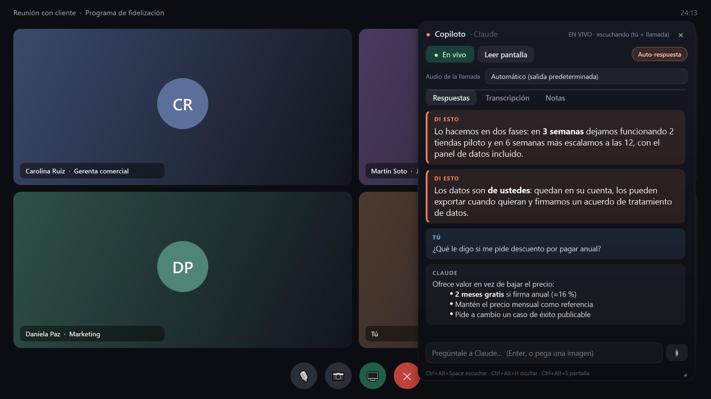
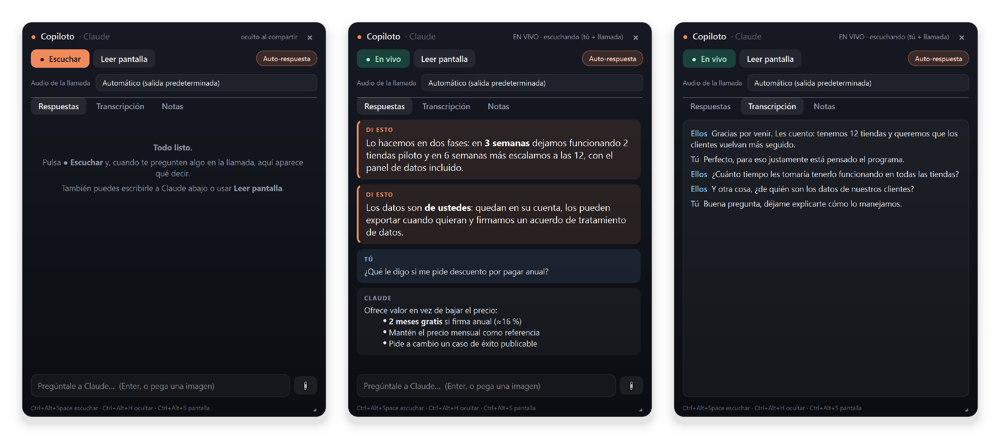
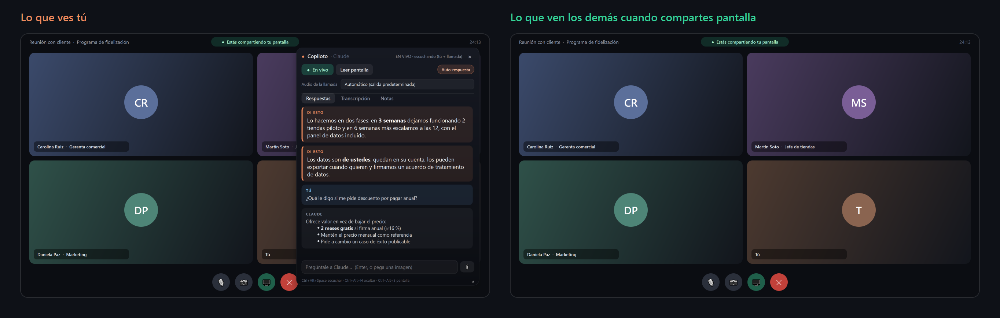
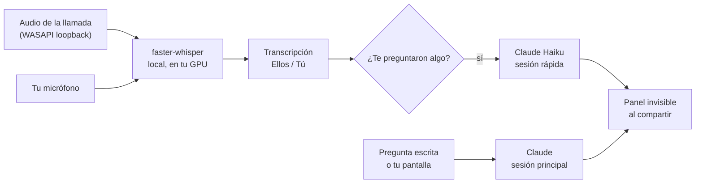

<div align="center">

# Copiloto

**Ocupa tu suscripción de Claude para apoyarte en las entrevistas.**

Un widget para Windows que escucha tu llamada, transcribe en tu PC y, cuando te
hacen una pregunta, te muestra qué responder en un par de segundos.
Sin API key y sin pagar por token: usa tu login de Claude Code (Pro o Max).



</div>

## Qué hace

- **Escucha las dos partes de la llamada.** El audio de los demás sale de tus parlantes (WASAPI loopback) y el tuyo del micrófono. Lo transcribe [faster-whisper](https://github.com/SYSTRAN/faster-whisper) en tu PC, en español por defecto.
- **Detecta cuándo te preguntan algo** (`¿…?`, “¿qué opinas?”, “cuéntanos…”, tu nombre) y te sugiere una respuesta corta, lista para decirla en voz alta.
- **Responde rápido.** La respuesta empieza a aparecer ~2 s después de que terminan de preguntar, y se va escribiendo en vivo.
- **Lee tu pantalla** con un atajo: un diagrama, una planilla, un correo, un problema de código.
- **No aparece al compartir pantalla** ni en grabaciones (`WDA_EXCLUDEFROMCAPTURE`).
- **Tus notas como contexto.** Lo que escribes en *Notas* (el cliente, tu propuesta, precios, objeciones) viaja con cada pregunta.

## Capturas



| Inicio | Respuestas | Transcripción |
| --- | --- | --- |
| El botón coral activa la escucha. | Las sugerencias (**DI ESTO**) van más grandes para leerlas de un vistazo. | Cada línea dice quién habló: **Ellos** o **Tú**. |

Así lo ve la otra persona cuando compartes pantalla:



> Las capturas se generan con `scripts/screenshots.py` usando datos de ejemplo
> inventados. El panel no se puede capturar con una captura de pantalla normal,
> justamente porque es invisible para ellas.

## Cómo funciona



Al abrirse, la app deja **dos procesos `claude -p` encendidos** (modo
`stream-json`), así cada pregunta es solo un viaje al modelo y no paga el
arranque de Claude Code cada vez. Esas sesiones se lanzan “peladas”:

| Flag | Para qué |
| --- | --- |
| `--tools ""` | Sin herramientas: nada de lo que se diga en la llamada puede hacer que Claude ejecute comandos o lea archivos. |
| `--strict-mcp-config`, `--setting-sources project`, `--disable-slash-commands` | Sin servidores MCP, plugins, hooks ni skills: arranca más rápido y gasta menos cuota. |
| `CLAUDE_CODE_DISABLE_CLAUDE_MDS=1` | No carga tus CLAUDE.md (el contexto baja de ~2.800 a ~1.000 tokens). |
| `--system-prompt` corto | Reemplaza el prompt de agente de Claude Code por uno de copiloto de reuniones. |
| `--no-session-persistence` | Lo que se habló no queda guardado en `~/.claude`. |

## Velocidad

Medido en un i7-7700HQ con GTX 1060 6 GB, Windows 10, suscripción de Claude:

| Etapa | Tiempo |
| --- | --- |
| Detectar que la persona terminó la frase (pausa de 0,5 s) y transcribirla con `small` en la GPU | ~1,0 s |
| Claude Haiku, desde que recibe el texto hasta la primera palabra | ~1,0 s |
| **Desde que terminan de preguntar hasta que ves la respuesta** | **~2,0 s** |
| Arranque, una sola vez al abrir (sesiones de Claude listas) | ~6 s |

Sin GPU, Whisper `small` tarda ~5 s por frase en ese procesador: funciona,
pero la respuesta llega bastante después. Con `large-v3-turbo` la puntuación
mejora un poco, pero en una GTX 1060 tarda ~2,6 s por frase.

## Requisitos

- Windows 10 (versión 2004 o posterior) u 11.
- Python 3.10 o posterior.
- [Claude Code](https://docs.claude.com/en/docs/claude-code) instalado y con sesión iniciada con tu cuenta Pro o Max (`claude` en la terminal debe funcionar).
- Opcional: GPU NVIDIA para transcribir más rápido. Sin GPU usa la CPU sola.

## Instalación

```powershell
git clone https://github.com/B3njjaman/copiloto-entrevistas.git
cd copiloto-entrevistas
python -m venv .venv
.\.venv\Scripts\python.exe -m pip install -r requirements.txt
```

Crea el acceso directo en el Escritorio y en el menú Inicio (una vez):

```powershell
powershell -ExecutionPolicy Bypass -File scripts\install_shortcut.ps1
```

¿Poco espacio en `C:`? Las librerías de CUDA pesan cerca de 1,5 GB. Puedes
crear el entorno en otro disco y apuntar el acceso directo a él con
`-Venv D:\ruta\al\venv`. Para guardar también allí los modelos de Whisper, usa
`CLUELY_WHISPER_DIR` (ver [Configuración](#configuración)).

## Uso

1. Abre **Copiloto** desde el acceso directo (o `.\.venv\Scripts\python.exe src\main.py`).
2. Escribe en **Notas** el contexto de la reunión: quién es el cliente, qué le ofreces, precios.
3. En **Audio de la llamada**, elige la misma salida que usa Zoom, Meet o Teams como altavoz.
4. Pulsa **● Escuchar**. Cuando te pregunten algo, aparece una tarjeta **DI ESTO**.

La primera vez descarga el modelo de Whisper (`small`, ~480 MB).

| Atajo | Acción |
| --- | --- |
| `Ctrl+Alt+Space` | Escuchar / dejar de escuchar |
| `Ctrl+Alt+H` | Mostrar / ocultar el panel |
| `Ctrl+Alt+A` | Escribirle a Claude |
| `Ctrl+Alt+S` | Leer la pantalla |
| `Ctrl+Alt+I` | Adjuntar imagen (portapapeles o archivo) |
| `Ctrl+Alt+T` | El mouse atraviesa el panel |
| `Ctrl+Alt+Q` | Guardar notas y salir |

## Configuración

Copia `copiloto.env.example` a `copiloto.env` y descomenta lo que quieras
cambiar (las variables de entorno reales tienen prioridad). Las variables
conservan el prefijo `CLUELY_` del proyecto original.

| Variable | Por defecto | Qué hace |
| --- | --- | --- |
| `CLUELY_MY_NAME` | vacío | Tu nombre: “Ana, ¿qué opinas?” cuenta como pregunta para ti. |
| `CLUELY_WHISPER_LANGUAGE` | `es` | Idioma de la llamada (`es`, `en`, … o `auto`). |
| `CLUELY_WHISPER_MODEL` | `small` | `small` es rápido; `medium` o `large-v3-turbo` son más precisos y más lentos. |
| `CLUELY_WHISPER_DEVICE` | `cuda` | `cuda` (GPU) o `cpu`. Si falla la GPU, cae a CPU solo. |
| `CLUELY_WHISPER_DIR` | caché de Hugging Face | Carpeta donde se descargan los modelos. |
| `CLUELY_PAUSE_SECONDS` | `0.5` | Silencio que marca el fin de una frase. Menos = respuesta antes, pero puede partir frases. |
| `CLUELY_CHUNK_SECONDS` | `6.0` | Largo máximo de una frase si la persona no hace pausas. |
| `CLUELY_AUTO_MODEL` | `haiku` | Modelo para las sugerencias en vivo. |
| `CLUELY_CLAUDE_MODEL` | el de tu cuenta | Modelo para preguntas escritas y de pantalla. |
| `CLUELY_AUTO_FROM` | `them` | Quién puede disparar una sugerencia: `them`, `you` o `both`. |
| `CLUELY_SPEAKER_DEVICE` / `CLUELY_MIC_DEVICE` | predeterminados | Fijar dispositivos por nombre. |
| `CLUELY_CLAUDE_CMD` | `claude` del PATH | Ruta al CLI de Claude si no está en el PATH. |
| `CLUELY_ANSWER_TIMEOUT` | `90` | Segundos antes de reiniciar una sesión colgada. |
| `CLUELY_ECHO_GUARD` | `1` | Descarta tu micrófono cuando repite lo que ya sonó por los parlantes. |
| `CLUELY_VISION_MONITOR` | `1` | Monitor que lee *Leer pantalla* (`0` = todos). |
| `CLUELY_OPACITY` | `0.93` | Opacidad del panel. |

## Solución de problemas

**Nunca aparecen líneas de “Ellos”.** La salida elegida en *Audio de la
llamada* no es la que usa tu app de videollamada. Elige la misma. Después de
~25 s sin audio de la llamada, el panel te avisa.

**Responde en otro idioma o transcribe mal.** Revisa `CLUELY_WHISPER_LANGUAGE`.
Si la llamada mezcla idiomas, prueba `auto`.

**“no response (… needs `claude` re-login)”.** Abre una terminal, ejecuta
`claude` y vuelve a iniciar sesión.

**Va lento al transcribir.** Si el estado dice “uso CPU”, la GPU no cargó.
Instala los drivers de NVIDIA al día. Para que la respuesta salga antes, baja `CLUELY_PAUSE_SECONDS` a `0.4`.

## Privacidad y uso responsable

- El audio se transcribe en tu PC. A Claude solo viaja texto (y la imagen de tu
  pantalla cuando tú la pides), por la misma sesión de Claude Code que ya usas.
- Las notas y transcripciones quedan en `notes/`, que está en `.gitignore`.
  Contienen palabras de otras personas: no las subas a ningún lado.
- Pensado para **tus** reuniones: llamadas con clientes, entrevistas que tú
  conduces, presentaciones y demos. No es para pruebas o evaluaciones donde se
  mide tu capacidad sin ayuda; el prompt se niega a producir contenido para
  engañar a quien te evalúa.
- Respeta las reglas de cada reunión y la ley local sobre transcribir conversaciones.
- Usa Claude Code en modo headless (`claude -p`) con tu propio login, y consume
  los límites de uso de tu suscripción. Es para uso personal: no lo ofrezcas
  como servicio con cuentas de otras personas.

## Créditos

Basado en [Ronils-Cluely-OPENSOURCE](https://github.com/ron2k1/Ronils-Cluely-OPENSOURCE)
de [@ron2k1](https://github.com/ron2k1) (Apache-2.0). Los cambios están en
[CHANGELOG.md](CHANGELOG.md) y en [NOTICE](NOTICE). “Cluely” es una marca de su
respectivo dueño; este proyecto no está afiliado a Cluely ni a Anthropic.

## Licencia

Apache-2.0. Ver [LICENSE](LICENSE).
